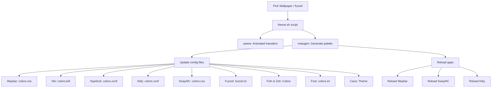

# Dotfiles: Niri on Arch Linux

My personal desktop setup on Arch Linux using the [Niri](https://github.com/YaLTeR/niri) scrollable tiling window manager. Colors update automatically from the wallpaper, and the terminal setup uses both Zsh and Fish.

> **Live site:**
> **[arch.masum.tech](https://arch.masum.tech)**

---

> [!NOTE]
> **Switched from Hyprland to Niri:**
> I recently moved from Hyprland to Niri as my main window manager.
> My full Hyprland setup (with Lua configs and custom stuff) is backed up on the **[`hyprland-archive`](https://github.com/insaneodyssey26/hyprland/tree/hyprland-archive)** branch. I won't be updating that branch anymore unless I ever go back. This `main` branch is now all about Niri.

---

## Screenshots

### Desktop


### Theme & Components


---

## What's Inside

*   **Scrollable Tiling**: Infinite horizontal workspace ribbon powered by Niri.
*   **Dynamic Colors**: Wallpaper colors extracted on the fly using Matugen.
*   **Smooth Wallpapers**: Animated transitions using `awww`.
*   **Dual Shells**: Synced aliases and shortcuts across Zsh and Fish.
*   **Clean Wayland Suite**: Waybar for the top bar, SwayNC for notifications, and Fuzzel for the launcher.
*   **Everyday Tools**: Native color picker, Satty screenshot editor, cliphist clipboard, and idle screen sleep.

---

## How Theming Works

When you pick a wallpaper, colors update and reload across open apps:



---

## Apps & Tools

| Part | Tool | Config Location | Notes |
| :--- | :--- | :--- | :--- |
| **Window Manager** | Niri | [niri/](niri/) | Scrollable tiling layout (`config.kdl`, `binds.kdl`, `rules.kdl`). |
| **Top Bar** | Waybar | [waybar/](waybar/) | Top status bar themed with Matugen colors. |
| **App Launcher** | Fuzzel | [fuzzel/](fuzzel/) | Minimal Wayland application launcher. |
| **Notifications** | SwayNC | [swaync/](swaync/) | Notification center and quick controls. |
| **Colors** | Matugen | [matugen/](matugen/) | Generates palettes from wallpapers. |
| **Terminals** | Kitty & Foot | [kitty/](kitty/), [foot/](foot/) | Fast GPU terminals. |
| **Shells** | Zsh & Fish | [.zshrc](.zshrc), [fish/](fish/) | Autosuggestions, syntax highlights, and shared aliases. |
| **Prompt** | Starship | [starship.toml](starship.toml) | Clean prompt across both shells. |
| **File Managers** | Nautilus & Yazi | System | Nautilus for GUI, Yazi for terminal. |
| **Lock Screen** | Hyprlock | [hyprlock/](hyprlock/) | Minimal lockscreen matching wallpaper colors. |
| **Idle Sleep** | Swayidle | [niri/config.kdl](niri/config.kdl) | Screen dimming and DPMS monitor sleep (no suspend freezes). |
| **Screenshots** | Grim, Slurp, Satty | [scripts/screenshot.sh](scripts/screenshot.sh) | Silent full screen or crop area with Satty editor. |
| **Audio Visualizer** | Cava | [cava/](cava/) | Audio visualizer in terminal. |

---

## Shortcuts

### Moving Windows & Columns

| Keys | What it does |
| :--- | :--- |
| `SUPER + Left / Right` | Move focus left or right between columns |
| `SUPER + Up / Down` | Move focus up or down between stacked windows |
| `SUPER + Ctrl + Left / Right` | Move column left or right |
| `SUPER + Home / End` | Jump to the very first or last column |
| `SUPER + R` | Cycle column widths (25%, 33%, 50%, 66%, 100%) |
| `SUPER + F` | Maximize column |
| `SUPER + SHIFT + F` | Fullscreen window |
| `SUPER + SPACE` | Toggle window floating |
| `ALT + TAB` | Open visual workspace overview |
| `SUPER + Q` | Close window |

### Apps

| Keys | What it does |
| :--- | :--- |
| `SUPER + T` | Open Kitty terminal |
| `SUPER + SHIFT + T` | Open Foot terminal |
| `SUPER + D` | Open Fuzzel app menu |
| `SUPER + G` | Search files |
| `SUPER + B` | Open Brave browser |
| `SUPER + SHIFT + B` | Open Brave without GPU compositing |
| `SUPER + E` | Open Nautilus file manager |
| `SUPER + SHIFT + E` | Open Yazi in terminal |
| `SUPER + C` | Open Calculator |
| `SUPER + SHIFT + R` | Open Rnote canvas |

### Tools & System

| Keys | What it does |
| :--- | :--- |
| `PRINT` | Fullscreen screenshot (saved silently to `~/Pictures/Screenshots/`) |
| `SHIFT + PRINT` | Select region to screenshot, copy to clipboard, click notification to open in Satty |
| `SUPER + V` | Open clipboard history |
| `SUPER + X` | Open task killer menu |
| `SUPER + P` | Open project switcher |
| `SUPER + K` | Toggle on-screen keyboard |
| `SUPER + N` | Toggle notification panel |
| `SUPER + H` | Toggle Waybar show/hide |
| `SUPER + S` | Open system power options in Fuzzel |
| `SUPER + W` | Open wallpaper selector |
| `SUPER + SHIFT + W` | Pick a random wallpaper |
| `SUPER + Y` | Pick a color from screen and copy hex code |
| `SUPER + L` | Lock screen |
| `SUPER + Escape` | Power menu |

---

## Installation

### What you need

*   Clean **Arch Linux** install.
*   Working internet connection.

### How to install

```bash
# Clone the repo
git clone https://github.com/insaneodyssey26/hyprland.git ~/hyprland

# Run setup
cd ~/hyprland
chmod +x setup.sh
./setup.sh
```

To start your session from TTY:
```bash
niri-session
```
