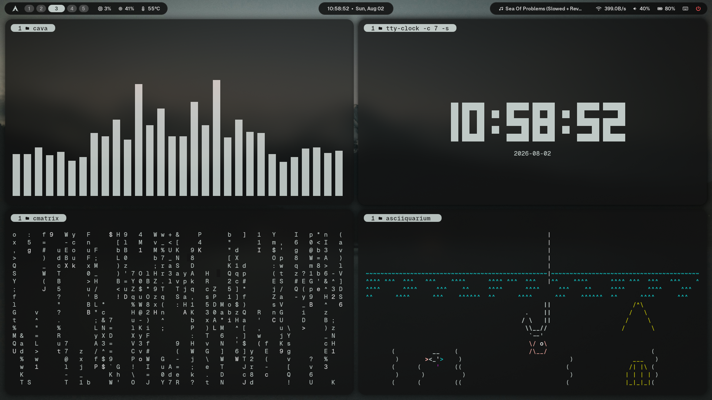
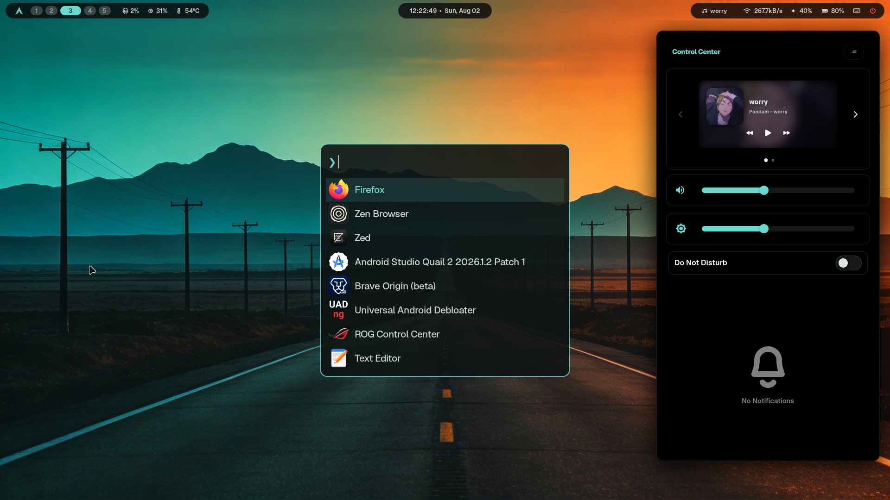
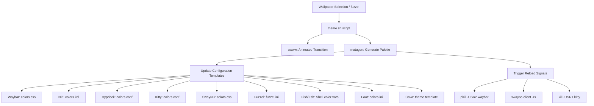

# Niri Dotfiles

A customized, scrollable-tiling Wayland desktop environment built on Arch Linux. Features dynamic wallpaper-based color generation, a modern Wayland utility suite, and an optimized terminal environment using Zsh and Fish.

## All configurations live on the web:
> **[masum.tech](https://masum.tech)**

---

## Previews

### Desktop


### Theme & Components


---

## Features

*   **Scrollable Tiling**: Seamless infinite horizontal ribbon workflow powered by Niri.
*   **Dynamic Theming**: Color schemes generated automatically from your wallpaper via Matugen.
*   **Wallpaper Transitions**: Smooth transitions powered by `awww`.
*   **Dual Shells**: Synchronized aliases and abbreviations in Zsh and Fish.
*   **Wayland Suite**: Integrated Waybar status bar, SwayNC notification drawer, and Fuzzel launcher.
*   **Utility Bindings**: Quick shortcuts for task management, clipboards, screenshots with Satty editor, and system controls.

---

## Theme Pipeline

Flow showing how wallpaper selection propagates colors and reloads active components:



---

## Components

| Component | Software | Directory / Config | Description |
| :--- | :--- | :--- | :--- |
| **Compositor** | Niri | [niri/](niri/) | Scrollable-tiling Wayland compositor (`config.kdl`, `binds.kdl`, `rules.kdl`). |
| **Status Bar** | Waybar | [waybar/](waybar/) | Modular status bar styled via Matugen. |
| **Application Launcher** | Fuzzel | [fuzzel/](fuzzel/) | Fast, minimal Wayland-native launcher. |
| **Notifications** | SwayNC | [swaync/](swaync/) | Custom notification center drawer. |
| **Theming Engine** | Matugen | [matugen/](matugen/) | Wallpaper color scheme generator and template parser. |
| **Terminals** | Kitty & Foot | [kitty/](kitty/), [foot/](foot/) | GPU-accelerated terminal emulators. |
| **Shells** | Zsh & Fish | [.zshrc](.zshrc), [fish/](fish/) | Auto-suggestions, syntax highlighting, and synchronized aliases. |
| **Shell Prompt** | Starship | [starship.toml](starship.toml) | Modern, cross-shell prompt theme. |
| **File Manager** | Nautilus & Yazi | System Packages | Graphical file manager (Nautilus) and terminal file manager (Yazi). |
| **Lock Screen** | Hyprlock | [hyprlock/](hyprlock/) | Wayland session locker with dynamic Matugen styling. |
| **Idle Management** | Swayidle | [niri/config.kdl](niri/config.kdl) | Lightweight DPMS idle monitor management. |
| **Screenshots** | Grim, Slurp, Satty | [scripts/screenshot.sh](scripts/screenshot.sh) | Region selection, clipboard copy, and annotation. |
| **Visualizer** | Cava | [cava/](cava/) | Audio spectrum visualizer. |

---

## Keybinds

### Window & Column Navigation

| Keybind | Action | Description |
| :--- | :--- | :--- |
| `SUPER + Left / Right` | Focus Column | Navigate between columns horizontally |
| `SUPER + Up / Down` | Focus Window | Navigate between stacked windows in a column |
| `SUPER + Ctrl + Left / Right` | Move Column | Move column left or right |
| `SUPER + Home / End` | Column Jump | Jump to first or last column |
| `SUPER + R` | Preset Width | Switch between preset column widths (25%, 33%, 50%, 66%, 100%) |
| `SUPER + F` | Maximize Column | Maximize active column to screen width |
| `SUPER + SHIFT + F` | Fullscreen | Fullscreen active window |
| `SUPER + SPACE` | Float Toggle | Toggle floating mode for active window |
| `ALT + TAB` | Overview | Toggle full desktop workspace overview |
| `SUPER + Q` | Close Window | Close focused window |

### Applications

| Keybind | Action | Description |
| :--- | :--- | :--- |
| `SUPER + T` | Terminal | Launch Kitty |
| `SUPER + SHIFT + T` | Terminal (fallback) | Launch Foot |
| `SUPER + D` | Application Menu | Open Fuzzel app launcher |
| `SUPER + G` | File Search | Run interactive file search |
| `SUPER + B` | Brave Browser | Open Brave |
| `SUPER + SHIFT + B` | Brave Browser (safe) | Open Brave with GPU compositing disabled |
| `SUPER + E` | File Manager | Open Nautilus |
| `SUPER + SHIFT + E` | Terminal File Manager | Open Yazi in Kitty |
| `SUPER + C` | Calculator | Open GNOME Calculator |
| `SUPER + SHIFT + R` | Drawing / Notes | Launch Rnote canvas |

### Utilities & Tools

| Keybind | Action | Description |
| :--- | :--- | :--- |
| `PRINT` | Screenshot (Full) | Capture full screen silently to `~/Pictures/Screenshots/` |
| `SHIFT + PRINT` | Screenshot (Region) | Crop area with Slurp, copy to clipboard, and click notification to edit in Satty |
| `SUPER + V` | Clipboard History | Open clipboard history in Fuzzel |
| `SUPER + X` | Task Killer | Process killer menu (`kill_task.sh`) |
| `SUPER + P` | Project Launcher | Select workspace project (`project_launcher.sh`) |
| `SUPER + K` | Virtual Keyboard | Toggle accessibility keyboard |
| `SUPER + N` | Notification Center | Toggle SwayNC drawer |
| `SUPER + H` | Toggle Status Bar | Show or hide Waybar |
| `SUPER + S` | System Menu | Open system actions menu via Fuzzel |
| `SUPER + W` | Wallpaper Selector | Open wallpaper picker |
| `SUPER + SHIFT + W` | Random Wallpaper | Apply a random wallpaper from `~/wallpapers/` |
| `SUPER + Y` | Color Picker | Pick color natively with Niri and copy hex to clipboard |
| `SUPER + L` | Lock Screen | Lock session with Hyprlock |
| `SUPER + Escape` | Power Menu | Open logout / shutdown menu |

---

## Installation

### Prerequisites

*   A clean installation of **Arch Linux**.
*   Active internet connection.

### Setup

```bash
# Clone the repository
git clone https://github.com/insaneodyssey26/hyprland.git ~/hyprland

# Run setup
cd ~/hyprland
chmod +x setup.sh
./setup.sh
```

After installation, start the session from TTY:
```bash
niri-session
```
